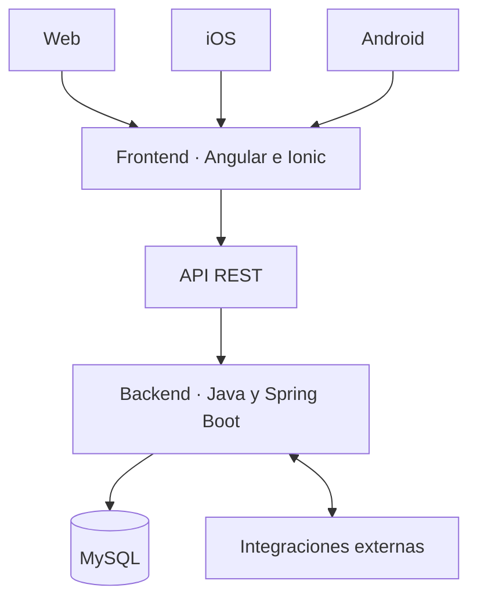

<h1 align="center">MeraCalendar</h1>

<strong>Organiza, comparte y descubre calendarios en un único lugar.</strong>

  <a href="https://meracalendar.com"><strong>Acceder a MeraCalendar</strong></a> ·
  <a href="https://meracalendar.com/public-calendars">Explorar calendarios públicos</a>

  
  
  
  
  
  

## Sobre el proyecto

**MeraCalendar** es una aplicación multiplataforma de gestión de calendarios que combina organización personal, planificación colaborativa y descubrimiento de calendarios públicos.

Su objetivo es trasladar la sencillez de los grupos de las aplicaciones sociales a la gestión del tiempo: crear espacios compartidos, organizar eventos y consultar toda la planificación desde una misma aplicación.

El proyecto está diseñado para web, iOS y Android, con una experiencia de usuario común entre plataformas.

## Funcionalidades principales

| Funcionalidad | Descripción |
| --- | --- |
| Calendarios colaborativos | Creación de grupos, invitaciones a miembros y gestión de permisos. |
| Gestión de eventos | Eventos con horarios, ubicaciones, descripciones, colores, categorías y recordatorios. |
| Eventos recurrentes | Configuración de repeticiones y patrones de recurrencia. |
| Calendario global | Consulta conjunta de eventos de diferentes grupos mediante vistas diaria, semanal, mensual y anual. |
| Calendarios públicos | Publicación, búsqueda y suscripción a calendarios de interés. |
| Personalización | Organización mediante categorías, colores y preferencias de visualización. |
| Integraciones | Importación y exportación de calendarios mediante iCalendar (ICS) e integración con Google Calendar. |
| Notificaciones | Avisos y recordatorios asociados a la actividad de los calendarios. |

## Casos de uso

- **Personal:** citas, tareas y planificación diaria.
- **Familias y amigos:** viajes, reuniones y actividades compartidas.
- **Equipos y organizaciones:** planificación de eventos y coordinación de miembros.
- **Calendarios públicos:** festivos, actividades culturales, eventos deportivos y otras fechas de interés.

## Arquitectura tecnológica

La aplicación se basa en una arquitectura cliente-servidor, con un frontend multiplataforma y un backend centralizado que gestiona la lógica de negocio y la persistencia de datos.

| Capa | Tecnologías |
| --- | --- |
| Frontend | Angular, TypeScript, Ionic |
| Aplicaciones móviles | Capacitor, iOS, Android |
| Backend | Java, Spring Boot |
| Persistencia | MySQL |
| Comunicación | API REST y Server-Sent Events (SSE) |
| Interoperabilidad | iCalendar (ICS), Google Calendar |

## Visión del producto

MeraCalendar busca evolucionar hacia una plataforma flexible donde los usuarios puedan crear, personalizar y compartir calendarios adaptados a distintos ámbitos de su vida.

Las principales líneas de evolución son la personalización de calendarios especializados, la mejora de la experiencia colaborativa, el descubrimiento de contenido público y la ampliación de las integraciones con otros servicios.

## Estado del proyecto

Proyecto de desarrollo independiente y en evolución continua.

## Autor

Desarrollado por [Fernando Fernández Verdejo](https://github.com/fernandofv25).

## Acerca de este repositorio

Este repositorio es el espacio público de presentación de MeraCalendar. Su finalidad es documentar el producto, sus funcionalidades y su arquitectura tecnológica a alto nivel.

El código fuente de la aplicación y sus configuraciones internas se mantienen en un repositorio privado. Este repositorio no constituye una distribución de código abierto ni concede una licencia sobre el software propietario.

---

<a href="https://meracalendar.com"><strong>meracalendar.com</strong></a>

