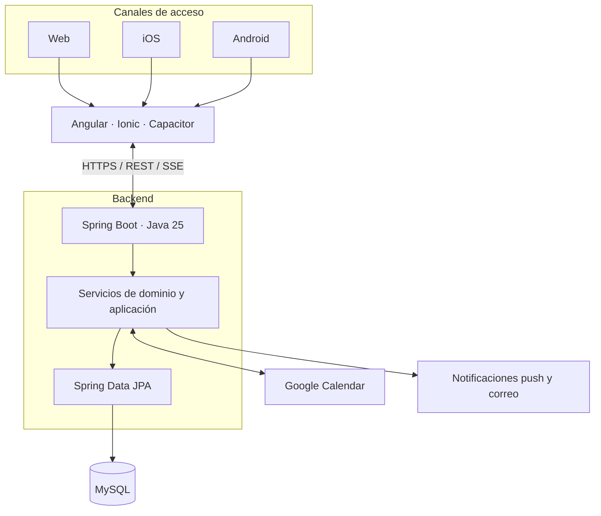
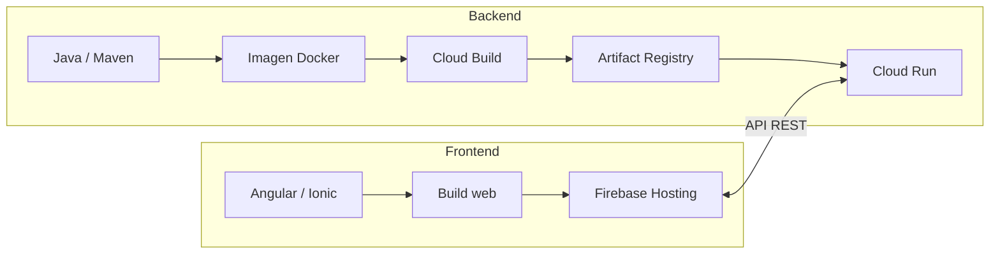

<h1 align="center">MeraCalendar</h1>

<strong>Una plataforma de calendarios colaborativos, diseñada y desarrollada de extremo a extremo.</strong>

  <a href="https://meracalendar.com"><strong>Acceder a la aplicación</strong></a>
  &nbsp;·&nbsp;
  <a href="https://meracalendar.com/web/help"><strong>Cómo funciona</strong></a>

Web · iOS · Android

  
  
  
  
  
  

  <a href="#producto">Producto</a> ·
  <a href="#arquitectura">Arquitectura</a> ·
  <a href="#stack-tecnológico">Tecnologías</a> ·
  <a href="#retos-de-ingeniería">Ingeniería</a> ·
  <a href="#despliegue">Despliegue</a>

---

## Producto

**MeraCalendar** es un proyecto de software independiente que combina gestión del tiempo, colaboración y descubrimiento de calendarios públicos. Su propuesta consiste en trasladar la sencillez de los grupos de las aplicaciones sociales a la planificación de eventos.

<table>
<tr><td width="50%"><strong>01 · Grupos colaborativos</strong> Calendarios compartidos, invitaciones, permisos y organización de miembros.</td><td width="50%"><strong>02 · Gestión de eventos</strong> Eventos recurrentes, horarios, recordatorios, ubicaciones y categorías.</td></tr>
<tr><td><strong>03 · Calendario global</strong> Visualización conjunta de eventos en vistas diaria, semanal, mensual y anual.</td><td><strong>04 · Descubrimiento</strong> Publicación, búsqueda y suscripción a calendarios públicos de diferentes temáticas.</td></tr>
<tr><td><strong>05 · Interoperabilidad</strong> Importación y exportación ICS e integración con Google Calendar.</td><td><strong>06 · Multiplataforma</strong> Experiencia común para navegador y dispositivos móviles, con preferencias y notificaciones.</td></tr>
</table>

## Arquitectura

Arquitectura cliente-servidor con un backend centralizado y organizado por capas. La interfaz comparte una base de código Angular e Ionic entre los distintos canales de acceso.

### Organización del software

| Capa | Responsabilidad |
|---|---|
| Presentación | Componentes reutilizables, navegación, vistas del calendario y formularios. |
| Servicios frontend | Consumo de APIs, sesión, interceptores HTTP, traducciones y notificaciones. |
| API REST | Controladores, contratos DTO y comunicación entre clientes y servidor. |
| Lógica de negocio | Gestión de usuarios, grupos, permisos, eventos, invitaciones e integraciones. |
| Persistencia | Entidades relacionales, repositorios JPA y evolución del esquema SQL. |
| Infraestructura | Contenedores, alojamiento web y despliegue en servicios cloud. |

## Stack tecnológico

| Área | Tecnologías y herramientas |
|---|---|
| Backend | Java 25, Spring Boot 3.5.14, Spring MVC, Maven |
| Persistencia | MySQL, Spring Data JPA, Hibernate, SQL |
| Frontend | Angular, TypeScript, Ionic, RxJS, HTML, SCSS |
| Mobile | Capacitor, integración con iOS y Android |
| Seguridad | Spring Security, JWT, autenticación con Google y verificación de correo |
| Comunicación | REST, JSON, HTTPS, Server-Sent Events (SSE) |
| Integraciones | Google Calendar, iCalendar (ICS), servicios de correo y notificaciones push |
| Cloud & DevOps | Docker, Google Cloud Run, Cloud Build, Artifact Registry, Firebase Hosting |
| Calidad | Pruebas de componentes y servicios frontend, Spring Boot Actuator, Git |

## Retos de ingeniería

### Modelado temporal y recurrencia

Gestión de eventos de día completo y con intervalos horarios, reglas de repetición y ocurrencias. La representación de eventos se adapta a distintas escalas temporales y vistas de calendario, contemplando el tratamiento de fechas y zonas horarias.

### Colaboración y control de acceso

Modelo relacional que vincula usuarios, grupos y eventos. La lógica de aplicación contempla membresías, invitaciones y permisos sobre recursos compartidos, junto con autenticación basada en tokens y protección de las rutas de acceso.

### Notificaciones y comunicación asíncrona

Canal SSE para actualizaciones de notificaciones, registro de dispositivos para comunicaciones push y gestión de recordatorios. El backend dispone de componentes de despacho y registro de entregas.

### Integración de calendarios externos

Servicios diferenciados para importar, publicar y sincronizar calendarios de Google, junto con procesamiento del formato iCalendar. El objetivo es facilitar la interoperabilidad con herramientas externas sin limitar la experiencia al ecosistema de MeraCalendar.

### Experiencia multiplataforma

Componentes reutilizables para vistas de calendario, servicios HTTP compartidos, navegación y gestión de sesión. Se contemplan adaptaciones específicas de plataforma, internacionalización y personalización de la interfaz.

### Mantenibilidad y calidad

Separación entre controladores, servicios, DTO, entidades y repositorios en el backend; organización por funcionalidades y servicios en el frontend. El proyecto incluye pruebas frontend para fechas, recurrencia, autenticación, sincronización y carga de vistas.

## Despliegue

El proyecto dispone de un proceso de construcción y despliegue diferenciado para frontend y backend.

El backend se empaqueta con Maven y se ejecuta como contenedor Java. El frontend web se compila y publica en Firebase Hosting. Los clientes móviles utilizan los servicios del backend común.

## Visión y evolución

El proyecto evoluciona hacia una plataforma de calendarios especializados y compartidos, con mayor flexibilidad de personalización, descubrimiento público e integración con servicios externos.

## Autor y alcance profesional

**[Fernando Fernández Verdejo](https://github.com/fernandofv25)** · Desarrollo Full Stack

Proyecto personal que abarca el ciclo de vida del producto: análisis funcional, diseño de experiencia de usuario, arquitectura, desarrollo frontend y backend, modelado de datos, integraciones, despliegue cloud y mantenimiento evolutivo.

## Sobre este repositorio

Este espacio público presenta el producto y su arquitectura a alto nivel. El código fuente, las configuraciones internas y los detalles de infraestructura permanecen en un repositorio privado. No se concede una licencia sobre el software propietario.

---

<strong>MeraCalendar</strong> Organiza tu tiempo. Comparte tus planes. <a href="https://meracalendar.com">meracalendar.com</a>

